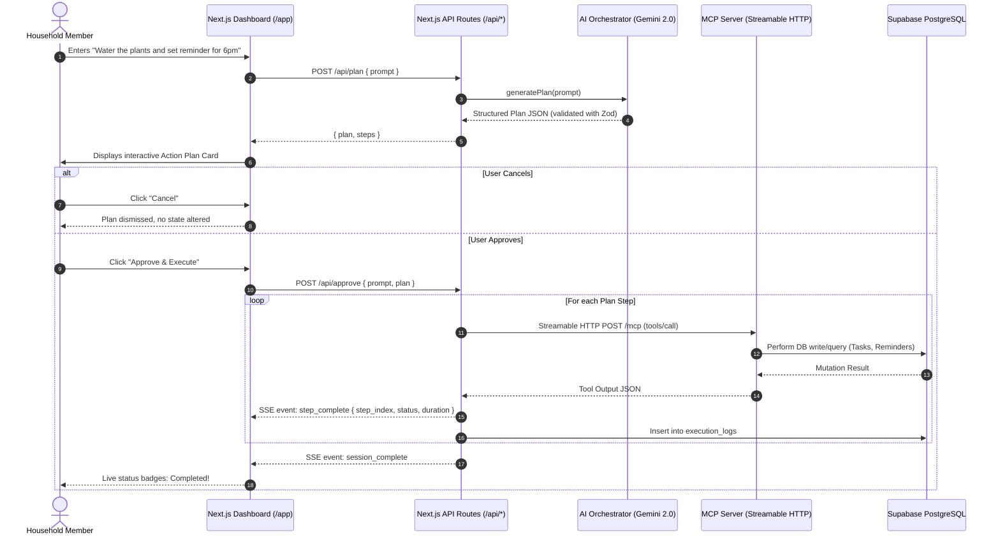

# 🏠 HomeRelay AI

> **Amazon Developer Hackathon 2026 Submission**  
> An AI-powered household coordination assistant that converts natural-language requests into structured multi-step plans and executes approved actions through Model Context Protocol (MCP) Streamable HTTP transport.

[](./tests)
[](./tests/e2e)
[](https://nextjs.org/)
[](https://modelcontextprotocol.io/)


---

## 🌟 Executive Summary

Home management is fragmented across disparate to-do apps, calendar reminders, delivery tracking portals, and mental overhead. **HomeRelay AI** provides a unified command center:

1. **Natural-Language Understanding:** Speaks household language ("Order groceries for dinner, remind me at 5pm, and check on that package").
2. **Explicit Plan Generation & Approval:** Uses Gemini 2.0 Flash (with OpenAI fallback) to produce validated JSON action plans with complete transparency before execution.
3. **Model Context Protocol (MCP) Standard:** Executes actions via a dedicated MCP Server operating over **Streamable HTTP transport** (`/mcp`), ensuring standardized tool discovery, security boundaries, and modular extensibility.
4. **Live SSE Execution Streaming:** Streams step-by-step progress back to the browser in real time via Server-Sent Events (SSE).
5. **Dark Navy & Teal SaaS Interface:** Crafted with a refined dark navy palette, restrained teal accents, subtle micro-animations, and full mobile responsiveness.

---

## 🏗️ Architecture & Data Flow



---

## 🔧 Model Context Protocol (MCP) Server

The MCP server runs as a standalone service (`src/mcp-server/index.ts`) using the official `@modelcontextprotocol/sdk` with **Streamable HTTP Transport**.

### Core Registered Tools

| Tool Name | Parameters | Description |
|---|---|---|
| `create_task` | `title`, `description?`, `priority?`, `due_date?` | Inserts a household task into Supabase |
| `list_tasks` | `status?`, `priority?`, `limit?` | Fetches tasks with ordering and status filtering |
| `update_task` | `id`, `title?`, `status?`, `priority?`, `due_date?` | Updates mutable fields of an existing task |
| `delete_task` | `id` | Permanently deletes a task by UUID |
| `create_reminder`| `message`, `remind_at` (ISO 8601) | Schedules a time-based household reminder |
| `list_reminders` | *(none)* | Retrieves upcoming and active reminders |
| `delete_reminder`| `id` | Removes a reminder by UUID |
| `lookup_parcel` | `tracking_number` | **[SIMULATED]** Looks up package delivery status from demo table |
| `get_household_summary` | *(none)* | Aggregates tasks, reminders, and recent execution metrics |

> **⚠️ Simulation Honesty Notice:** Carrier tracking (`lookup_parcel`) queries a local PostgreSQL table populated with demo tracking numbers (e.g., `DEMO-TRK-001`). No real carrier APIs (FedEx, UPS, USPS, DHL) are called, and all payloads explicitly include `"simulated": true`.

---

## 💻 Tech Stack & Environment

- **Frontend & App Framework:** Next.js 16 (App Router, Turbopack, React 19)
- **Styling:** Vanilla CSS design system + Tailwind CSS utilities with custom CSS tokens
- **Icons & UI:** Lucide React, Sonner toast notifications, Radix UI primitives
- **AI Orchestration:** Google Gemini 2.0 Flash (`@google/generative-ai`) with OpenAI fallback
- **Protocol:** Official Model Context Protocol TypeScript SDK (`@modelcontextprotocol/sdk`)
- **Database:** Supabase PostgreSQL with service-role security and committed migrations
- **Data Validation:** Zod schemas across all API endpoints and MCP tools
- **Unit Testing:** Vitest 5 with v8 coverage (144 unit and integration tests across 11 suites)
- **E2E Testing:** Playwright 1.64 for cross-browser and mobile verification (12 specs covering 7 evaluation journeys)
- **Target OS:** macOS Apple Silicon (M1) / Linux / Node.js 20+


---

## 🚀 Quickstart & Local Setup

### 1. Clone & Install Dependencies

```bash
git clone https://github.com/h4rsh740/homerelay-ai.git
cd homerelay-ai
npm install
```


### 2. Configure Environment Variables

Create `.env.local` from `.env.example`:

```bash
cp .env.example .env.local
```

Fill in your configuration:

```env
# Supabase
NEXT_PUBLIC_SUPABASE_URL=https://your-project.supabase.co
NEXT_PUBLIC_SUPABASE_ANON_KEY=your-anon-key
SUPABASE_SERVICE_ROLE_KEY=your-service-role-key

# AI Provider (Gemini is free and recommended)
AI_PROVIDER=gemini
GEMINI_API_KEY=your-gemini-api-key

# MCP Server
MCP_SERVER_URL=http://localhost:3001/mcp
MCP_SERVER_SECRET=local-development-secret-key-32-chars

# App
NEXT_PUBLIC_APP_URL=http://localhost:3000
```

### 3. Initialize Database Schema

Run the SQL migration in your Supabase SQL editor:
- [`lib/db/schema.sql`](./lib/db/schema.sql)

### 4. Run the Application

In terminal 1, start the MCP Server:
```bash
npm run dev:mcp
```

In terminal 2, start the Next.js Web App:
```bash
npm run dev
```

Visit [http://localhost:3000](http://localhost:3000) to start managing your household!

---

## 🗄️ Phase 2: Persistent Supabase Storage

The Phase 2 storage model is defined by the migration at
[`supabase/migrations/20261013000000_phase_2_storage_foundation.sql`](./supabase/migrations/20261013000000_phase_2_storage_foundation.sql).
It creates `tasks`, `reminders`, `demo_parcels`, and `execution_logs` with UUID
keys, timestamps, constraints, indexes, and deny-by-default RLS policies for
public roles. The server-only database service lives under [`lib/db/`](./lib/db).

### Apply the migration

With the Supabase CLI linked to the project:

```bash
supabase db push
```

Alternatively, open the Supabase SQL Editor and run the migration file. The
optional compatibility block preserves rows from the prototype `parcels` and
`execution_history` tables if those tables already exist.

### Seed clearly marked sample rows

Copy `.env.example` to `.env.local`, then provide real Supabase values. Keep
`SUPABASE_SERVICE_ROLE_KEY` server-side; never prefix it with `NEXT_PUBLIC_` or
import the database service into a client component.

```bash
npm run db:seed -- --dry-run
npm run db:seed
```

The seed is idempotent and writes only `[DEMO]` tasks/reminders and
`[SIMULATED DATA]` parcels with `DEMO-TRK-*` tracking numbers. It refuses
placeholder credentials. `--allow-unconfigured` is an explicit no-write mode
for local inspection only.

### Verify that records persist

After `npm run db:seed`, run these read-back queries in the Supabase SQL
Editor. The counts and rows should remain after restarting the Next.js app:

```sql
select id, title, status, created_at
from public.tasks
where title like '[DEMO]%'
order by created_at;

select id, message, remind_at, is_sent
from public.reminders
where message like '[DEMO]%'
order by remind_at;

select tracking_number, carrier, simulated, description
from public.demo_parcels
order by tracking_number;

select session_id, step_index, status, created_at
from public.execution_logs
order by created_at desc
limit 20;
```

The application API routes read and write through the server-only service layer;
direct anon-key and authenticated-client access remain blocked by RLS until
household-scoped authenticated policies are deliberately introduced.

---

## 🧪 Testing Suite

### Unit Tests (Vitest)
HomeRelay AI maintains rigorous test coverage over validators, AI prompts, MCP client, and all 9 MCP tools:

```bash
npm test
# Or with coverage report:
npm run test:coverage
```

### End-to-End Tests (Playwright)
```bash
npm run test:e2e
```

---

## 📁 Repository Structure

```
homerelay-ai/
├── app/
│   ├── layout.tsx            # Global dark navy shell & navigation
│   ├── page.tsx              # Command input, plan review, live SSE log
│   ├── tasks/page.tsx        # Tasks management & status badges
│   ├── reminders/page.tsx    # Reminders scheduling & relative times
│   ├── history/page.tsx      # Execution history grouped by session
│   └── api/                  # Server-side API route handlers
├── components/
│   ├── sidebar.tsx           # Navigation sidebar & MCP health indicator
│   └── providers.tsx         # React Query & client contexts
├── lib/
│   ├── ai/                   # Gemini & OpenAI plan generation orchestrator
│   ├── db/                   # Supabase client & SQL schema
│   ├── mcp/                  # Streamable HTTP MCP client
│   └── validators/           # Zod single source of truth schemas
├── src/
│   └── mcp-server/           # Standalone HTTP MCP server and 9 tools
└── tests/
    ├── unit/                 # Vitest unit test suite (144 tests across 11 suites)
    └── e2e/                  # Playwright browser end-to-end specs (12 tests)
```


---

## 🏆 Hackathon Evaluation Highlights

1. **Working MCP Integration:** Unlike mock agents, HomeRelay AI integrates the official TypeScript MCP SDK with Streamable HTTP transport, separating LLM planning from execution.
2. **Safety & Human Confirmation:** Destructive actions and complex plans require human visual inspection and explicit approval before any tool calls are executed.
3. **Resilience & Graceful Fallbacks:** Built-in retries with automatic schema correction, support for both Gemini and OpenAI providers, and comprehensive unit and E2E test suites.
4. **Design Excellence:** Professional, restrained dark navy aesthetic with accessible contrast and responsive layouts.
